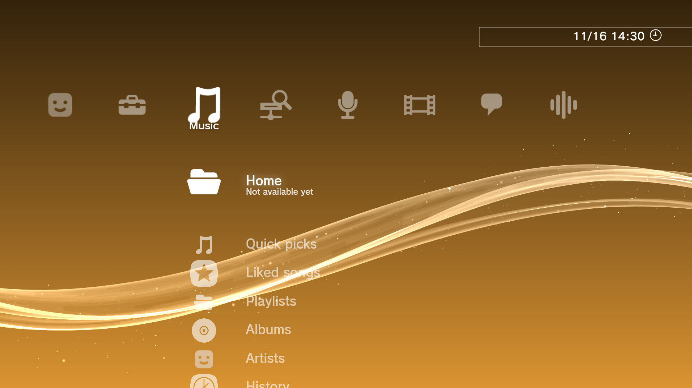
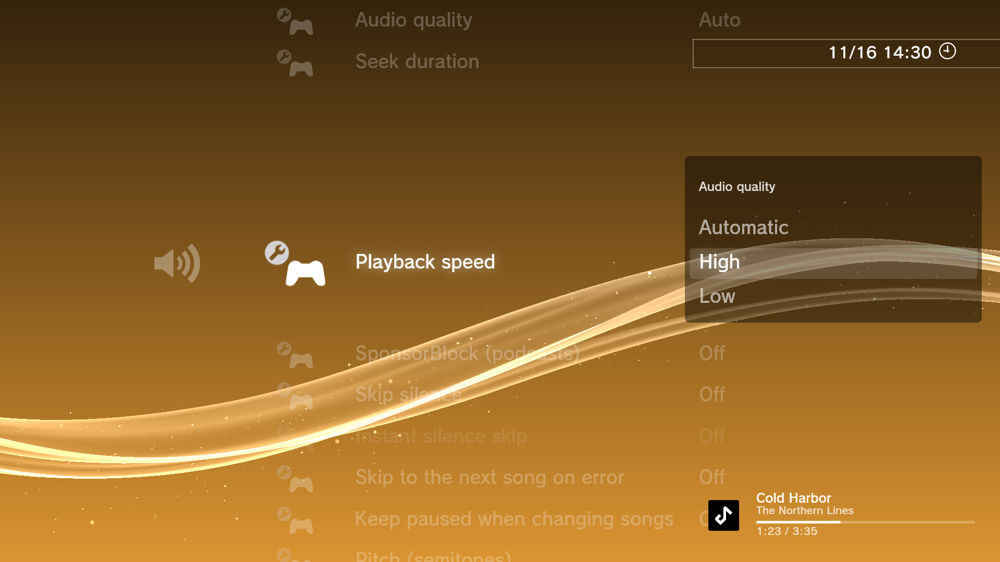
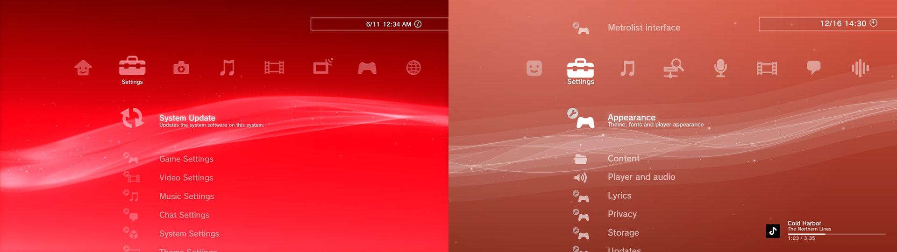

# XMB Music

A YouTube Music player with a PlayStation 3 XrossMediaBar (XMB) front end, built on
[Metrolist-KMP](https://github.com/MetrolistGroup/Metrolist)'s source code. Metrolist's backend
(streaming, playback, library, lyrics, casting, MetroEQ, Listen Together) is kept as is; this
project replaces Metrolist's interface with an XMB and adds live replicas of the PS3's music
visualizers. On desktop the XMB is the only interface.

> [!IMPORTANT]
> **Private project.** The repository and its builds contain Sony PS3 assets (the Rodin font and
> system sounds) for personal use. Keep the repository private and don't share builds.

> [!WARNING]
> Using a third-party client to access YouTube Music may violate YouTube's Terms of Service. You
> use it at your own risk.

| The XMB | A setting's value picker |
|---|---|
|  |  |



<sub>Rendered with `scripts/xmb/snap.sh`; music captures use demo data. Bottom: a PS3 frame (left)
next to the XMB in December (right).</sub>

## Status

**Current milestone: M6 done (desktop); M4 and M5 on hold.** The XMB runs on desktop (Windows,
macOS, Linux): music, podcasts, music videos, search, Listen Together, lyrics, casting, every
setting and sign-in, and the Waves visualizer. The stock desktop screens are removed. Android keeps
the stock Metrolist interface until M7 replaces it. iOS was removed.

| | Milestone | Status |
|---|---|---|
| M0 | Map the codebase: entry points, data sources, touchpoints ([docs/xmb-architecture.md](docs/xmb-architecture.md)) | ✅ Done |
| M1 | XMB shell on desktop: category row, item columns, focus motion, monthly background, wave, sounds, Rodin font, interface-style switch | ✅ Done |
| M2 | Music: home feed, quick picks, liked songs, playlists, albums, artists, history, downloads; playback; drill-down; △ options; now playing | ✅ Done |
| M3 | Search with an XMB on-screen keyboard; every setting in the XMB Settings column; account sign-in; layout matched to console frames; the home wave with sparkles reacting to navigation | ✅ Done |
| M4 | The Waves visualizer for real: layered ribbons reacting to the music; full-screen visualizer mode | On hold: matched to the owner's videos, not yet checked with real music |
| M5 | Valley (raymarched terrain) and Gaia (day/night Earth) visualizers | On hold (reference stills saved) |
| M6 | Podcasts, Video, Friends (Listen Together), lyrics view, casting picker | ✅ Done |
| M7 | Android, Android TV and touch: gestures, phone and tablet layouts, D-pad, quality settings; the XMB replaces Android's stock UI | Planned |

**After the core:** theme picker (monthly, fixed, custom or album-art colors), lyrics over the
waves, beat-synced colors, party mode, shared visualizers in Listen Together rooms, gamepad-driven
sparkles, a desktop wallpaper mode, importable XMB themes, more visualizers, and a TV mode that
boots straight into the XMB. The full plan is in [PLAN.md](PLAN.md).

## What works now

- **XMB only.** After first-run setup the desktop app shows the XMB. A few standard windows still
  open over it where the XMB has no screen of its own yet: some settings pages, sign-in, the
  mini-player and the tray.
- **Menu.** Eight categories (Users, Settings, Music, Search, Podcasts, Video, Friends,
  Visualizer) with the console's focus behavior: the focused icon grows and glows, labels fade,
  lists scroll with easing, items above the focus jump over the category row, and each category
  remembers its position.
- **Music.** Home (each shelf opens as a folder), Quick picks, Liked songs, Playlists, Albums,
  Artists, History and Downloads. Albums, playlists and artists open further levels. Selecting a
  song plays its list from that song.
- **△ options.** Play, Shuffle, Play next, Add to queue, Start radio, Like/Unlike,
  Download/Remove download, View album, View artist.
- **Settings.** Every page of Metrolist's settings as XMB lists with the current value on the
  right. Switches and choices open a value list, sliders a slider, text the on-screen keyboard;
  nothing changes until ✕ confirms. Pages with their own screens (storage, backup, updates, about,
  MetroEQ, fonts) open the standard settings window over the XMB.
- **XMB settings.** Five pages at the top of the Settings column:
  - **Theme Settings:** color (the console's monthly color, any one month's color all year, or a
    custom hue), dim at night, a background image with dimming, and the wave, sparkles, the wave
    reacting to the menu, and wave speed.
  - **Date and Time Settings:** show the clock, 12- or 24-hour time, date order or no date.
  - **Sound Settings:** menu sounds on or off, and their volume.
  - **Keyboard Shortcuts:** remappable keys, with Ctrl, Shift and Alt combinations:
    - Playback: play/pause, next, previous, seek ±10 s, shuffle, repeat.
    - Volume: up, down, mute.
    - Other: like, visualizer, lyrics, search.
  - **Music Player Settings:** the now-playing card, the track info over the visualizer
    (briefly, always or never), and opening Waves after the menu is left alone while music plays.
- **Search.** New search opens the on-screen keyboard: type on your keyboard or pick keys with
  the arrows, with suggestions in a column on the right. Results open as folders (top result,
  songs, albums, artists...). Recent searches are listed under New search.
- **Users.** Log in when signed out; when signed in, your account (select it to switch channel)
  and Log out, after a Yes/No.
- **Visualizer.** Visualizer > Waves plays full screen: the ribbon low on a violet sky, moving with
  the music (bass deepens it, louder passages add silk lines and make the particles streak), with
  the console's track overlay (artwork, title, artist / album, queue position, time, codec badge
  and progress). ○ returns to the
  XMB; any other key shows the track for a few seconds. Valley and Gaia come in M5.
- **Podcasts.** Subscriptions (each opens its episodes), New episodes and Episodes for later.
- **Video.** Watch video shows the playing song's music video full screen; Liked videos and Music
  videos (from the home feed) play full screen when selected. ○ goes back.
- **Friends.** Listen Together: turn it on, create a room or join one by code on the keyboard, set
  your name, see who's in the room, let people in, copy the invite link, leave.
- **Lyrics.** Music > Lyrics shows the playing song's synced lyrics full screen, the current line
  glowing; △ shows them over a visualizer too.
- **Play on device.** Music > Play on device lists cast devices (Google Cast, DLNA, Sonos, FCast)
  while it's open; select one to play there, select it again to come back.
- **Now playing.** Artwork, title, artist and progress in the bottom right.
- **Look and sound.** Layout measured from console frames: category row, item spacing, title
  placement, the clock box. The PS3 monthly background colors, dark at the top and bright at the
  bottom, dimmed in the evening; the XMB ribbon with drifting, twinkling particles (a port of
  RetroArch's ribbon), reacting to navigation (moving pushes it sideways or lifts it, ✕ brightens
  it); album art in lists; the Rodin font with normal
  fallback for non-Latin text; navigation sounds.
- Placeholders in the other categories show "Not available yet" and play the error sound.

### Controls

| Key | Action |
|---|---|
| Arrow keys | Move |
| Enter | Select (✕) |
| Esc, Backspace | Back (○); also Left inside a folder |
| Tab | Options (△) |
| Media keys | Play/pause, next, previous (always) |
| Space | Play/pause |
| Ctrl+Right / Ctrl+Left | Next / previous track |
| Shift+Right / Shift+Left | Forward / back 10 seconds |
| Ctrl+Up / Ctrl+Down, M | Volume up / down, mute |
| Ctrl+S, Ctrl+R | Shuffle, repeat |
| H, V, L, Ctrl+F | Like, visualizer, lyrics, search |
| Mouse wheel | Move up and down |
| Typing (keyboard open) | Letters go straight into the text, Backspace deletes, Enter submits, Esc cancels |
| Full screen (visualizer, video, lyrics) | ○ goes back, △ shows or hides lyrics over a visualizer, any other key shows the track |

Every shortcut can be changed in Settings > Keyboard Shortcuts: select it and press the new key
(hold Ctrl, Shift or Alt for a combination; Esc cancels, Backspace clears). Arrow keys, Enter,
Esc, Tab and media keys need a modifier there, because they move through the menu.

Controllers work on Android (M7); on desktop the UI toolkit has no gamepad input yet.

## Getting it

### Windows (portable)

`scripts/xmb/package_windows_portable.sh` builds a portable Windows x64 ZIP from Linux: unzip it
and run `Metrolist.cmd`. It bundles its own Java runtime. The ZIP's `README.txt` lists what that
build lacks (no YouTube sign-in helper, a `.cmd` launcher instead of an `.exe`).

### From source

Needs JDK 25 (Eclipse Temurin; the build requires the Adoptium vendor) and, for Android, the
Android SDK with `platforms;android-37.1`. See [docs/development.md](docs/development.md).

```bash
git submodule update --init --recursive
./gradlew :desktopApp:run                  # desktop
./gradlew :androidApp:assembleDebug        # Android (stock interface until M7)
```

A cold Gradle cache can hit Maven Central rate limits (HTTP 429); a first run with
`--max-workers=1 --no-parallel --no-configuration-cache` gets past them.

## Project layout

XMB code lives in the shared module; platform glue sits in each app.

| Path | What |
|---|---|
| `shared/.../shared/xmb/` | `XmbApp` (root), `nav/` (categories, navigation, input, options), `bar/` (category row, item columns, folder levels), `adapters/` (music lists from the shared ViewModels and database), `screens/` (options panel, now playing), `sound/`, `theme/` (palette, layout, motion, icons) |
| `shared/.../shared/visualizer/` | Background and, from M4, the visualizers |
| `shared/src/commonMain/composeResources/` | `drawable/xmb_*`, `font/xmb_rodin_latin_regular.ttf`, `files/xmb/sounds/` |
| `desktopApp/.../desktop/xmb/` | Desktop host: playback, downloads, image loading, sounds |
| `scripts/xmb/` | Snapshot capture and Windows packaging |
| `reference/`, `compare/` | Console reference frames and the XMB captures to compare against them |

## Documentation

| Document | Contents |
|---|---|
| [PLAN.md](PLAN.md) | Goals, XMB layout, milestones and extras |
| [CLAUDE.md](CLAUDE.md) | Project rules: git, technical constraints, code location, tests |
| [docs/xmb-architecture.md](docs/xmb-architecture.md) | How the XMB plugs into Metrolist: entry points, data, playback, settings, menus, audio meter, shaders, input |
| [docs/xmb-assets.md](docs/xmb-assets.md) | The PS3 asset manifest (checked by a test) |
| [docs/xmb-notes.md](docs/xmb-notes.md) | Every tuned constant and why |
| [compare/README.md](compare/README.md) | What each capture shows and what still differs from the console |
| [UPSTREAM_TOUCHPOINTS.md](UPSTREAM_TOUCHPOINTS.md) | Every edit to an upstream Metrolist file |
| [docs/](docs/README.md) | Metrolist's own documentation (build, playback, rendering, strings, checks) |

## Development

- One branch per milestone (`feat/xmb-m<N>-<name>`), merged into `main` when done. GitHub Actions
  are removed; checks run locally.
- XMB tests: `./gradlew :shared:desktopTest -x :shared:testServerWithoutReflection --tests
  'com.metrolist.shared.xmb.*'`. They cover navigation, input, palette, catalog, the asset
  manifest, sound decoding, the music lists, the options, settings rows and pickers, the
  on-screen keyboard, search results and the wave's reactions.
- Captures: `scripts/xmb/snap.sh [screen]` renders the XMB headlessly into `compare/`.
- Format changed Kotlin with the module's `ktlint…Format` tasks.
- Pulling a new Metrolist release: merge `upstream`, keep this README and `CLAUDE.md`, keep the
  GitHub Actions files, the iOS app and the removed desktop screens deleted, and check each file
  listed in `UPSTREAM_TOUCHPOINTS.md`.

## Known limits

- Navigation sounds decode and load (tested), but nobody has listened to them on real hardware
  yet.
- The Windows portable build is assembled on Linux. The title bar over the XMB and the
  keys-after-Alt+Tab fix were checked on Linux only.
- Sign-in on Linux needs WebKitGTK 4.1 (`libwebkit2gtk-4.1-0`), as in the standard interface.
- Searches made in the XMB show up in the standard search screen's history after a restart.
- The on-screen keyboard and value pickers have no console frames to match yet.
- Features without an XMB screen yet (statistics, playlist editing) aren't reachable on desktop;
  their settings are in the Settings column.
- Podcasts, videos and Listen Together were built and tested without network access to YouTube or
  the Listen Together server; full-screen video was only checked with a stand-in frame.
- `users.png` and `artist.png` are 68×68 and look soft when enlarged.
- Layout, timing and colors are first passes until console reference frames are added to
  `reference/` ([compare/README.md](compare/README.md) lists what to check).

## License and credits

GPL-3.0, like Metrolist. Based on [Metrolist](https://github.com/MetrolistGroup/Metrolist) by
MetrolistGroup and its contributors; see [LICENSE](LICENSE). This project isn't affiliated with
MetrolistGroup, YouTube or Sony. PlayStation, XMB and the PS3 system assets are Sony's; they're
included only for personal use. The Podcasts and Visualizer category icons were drawn for this
project. The XMB ribbon and its particles are ported from [tsbehlman/xmb](https://github.com/tsbehlman/xmb),
itself adapted from [RetroArch](https://github.com/libretro/RetroArch)'s XMB ribbon shader (both GPL-3.0).
